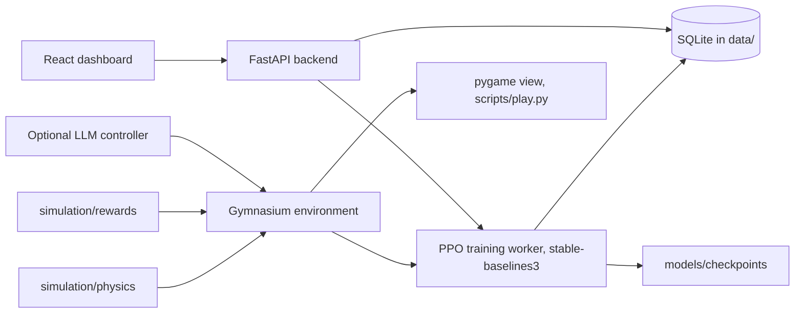

# LunarMind

LunarMind (this repository, `llm-lunch-rocket-simulator-`) is a reinforcement learning project for people curious about how reward design shapes learning: a PPO agent tries to learn to land a 2D rocket by trial and error, and an optional language model controller can fly the same rocket for comparison. The rocket moves only because forces are integrated, and the agent moves it only by choosing a thruster. There is no scripted landing.

The default reward is the requested baseline:

- distance: `5 * (previous_distance - current_distance)`
- speed: `3 * (previous_speed - current_speed)`
- upright: `2 * (previous_tilt - current_tilt)`
- safe landing: `+100`
- crash: `-1000`

Fuel use and flight time do not change the score. Truncation at the step limit is neither a landing nor a crash. An optional potential-based reward is available and is labelled on the experiment. It is not the default.

A high landing rate is a research outcome. The software is complete when the physics, reward, training loop, telemetry and dashboard work, even if a particular run has not learned to land.

## How it works



## Layout

- `simulation/` physics, reward, Gymnasium environment, pygame view
- `backend/` FastAPI, SQLite, PPO worker, controllers
- `frontend/` React dashboard
- `tests/` physics, reward, API and a small PPO smoke test
- `docs/` architecture and the research protocol

## Setup

```bash
python3 -m venv .venv
source .venv/bin/activate        # Windows: .venv\Scripts\activate
pip install -e ".[dev]"
pytest
```

PyTorch is a large download. On a machine without a GPU you can add `--extra-index-url https://download.pytorch.org/whl/cpu` to get the smaller CPU build.

LunarLander-v3 can be used as an external baseline only when Box2D imports. It is not required. Its reward includes fuel costs, so its scores are not LunarMind scores.

```bash
pip install -e ".[baseline]"
```

## Train and fly

Dashboard:

```bash
cd frontend
npm install
cd ..
python scripts/dev.py
```

The script prints the dashboard URL. It uses port 8000 for the API and port 5173 for the dashboard, and moves to the next free port when one of those is already taken. The dashboard proxy follows the API port.

The two processes can also be started separately when those ports are free:

```bash
uvicorn backend.api.app:app --port 8000
cd frontend
npm run dev
```

Pygame, without the dashboard:

```bash
python scripts/play.py --controller human
python scripts/play.py --controller random --seed 0
```

TensorBoard, after a run has written logs:

```bash
tensorboard --logdir data/tensorboard
```

The training worker is a separate process. Restarting the API does not delete SQLite rows, checkpoints or trajectories. A worker that is still alive keeps training. A worker that has died is marked failed and its saved checkpoints remain.

## Controls

The action space is discrete. One thruster per physics step:

| Action | Key | Effect |
| --- | --- | --- |
| 0 coast | none | Gravity and momentum only |
| 1 main | Space | Thrust along the nose |
| 2 left | Left arrow | Counter-clockwise torque, nose toward -x |
| 3 right | Right arrow | Clockwise torque, nose toward +x |

Holding a key repeats that action. If several keys are held, the most recently pressed one is used.

## What a run records

Every experiment stores its seed, PPO settings, physics, reward mode, package versions and step count. Training episodes and evaluation episodes are stored separately. Charts on the Analytics page read those rows. They are empty until a real run produces them.

The language-model controller is optional. Set `OPENAI_API_KEY` (see `.env.example`). It must return JSON `{"action": 0, "reason": "..."}`. Invalid output coasts. Token counts and latency are stored on the flight trace and are not part of the reward. Prompting a model is not reinforcement learning.

## Tests

`pytest` includes a smoke test that trains a tiny PPO model, saves it, reloads it and evaluates one episode. That test checks the pipeline. It does not claim the policy can land.

## Verified run

Checked on 1 November 2026 on Linux with Python 3.12 (CPU PyTorch) and Node 20.

| Check | Result |
| --- | --- |
| `pip install -e ".[dev]"` | ok |
| `pytest` | 45 passed in 7.3 s, including the PPO smoke test |
| `ruff check` (pyflakes and error rules) | 4 findings: 3 unused imports, and an undefined name `sqlite3_row` used only in a type hint in `backend/storage/repository.py` |
| `npm ci && npm run build` (frontend) | ok, with Vite's chunk size warning |
| API: health, create experiment, start, checkpoints, analytics | ok |
| CI | none |
| pygame window and the LLM controller | not run (no display, no API key) |

A short training run through the API (seed 1, 8,192 steps, 512 steps per update, batch 64, 3 evaluation episodes per checkpoint) finished in a few seconds. It is a pipeline check, not a landing result:

| Checkpoint | Mean evaluation reward | Landings | Crashes | Timeouts |
| --- | --- | --- | --- | --- |
| 0 steps | -980.4 | 0 of 3 | 3 of 3 | 0 of 3 |
| 8,192 steps | -801.0 | 0 of 3 | 2 of 3 | 1 of 3 |

The analytics endpoint reported a landing count of 0 for the training episodes in that run. See [docs/research/results.md](docs/research/results.md) for the earlier pipeline check. No multi seed landing study has been run yet.

## Configuration

- `experiments/configurations/default.json` holds the default experiment (100,000 steps, Moon gravity 1.62 m/s², the baseline reward weights).
- Every field can also be set when creating an experiment through `POST /api/v1/experiments` or the dashboard. The landing bonus and crash penalty are fixed and cannot be overridden.
- `LUNARMIND_DATA` and `LUNARMIND_MODELS` move the SQLite database and checkpoints away from `data/` and `models/`.
- `OPENAI_API_KEY` turns on the language model controller (see `.env.example`).

More detail: [API](docs/architecture/api.md), [physics](docs/architecture/physics.md), [observations](docs/architecture/observations.md), [rewards](docs/architecture/rewards.md), [research protocol](docs/research/protocol.md).

## Limitations

- The vehicle is a 2D rigid body with the equations in `docs/architecture/physics.md`, not a 6-degree-of-freedom aerospace model.
- There is no atmosphere and no drag.
- Attitude thrusters are a pure couple, so they rotate the rocket without pushing it sideways.
- Touchdown is decided on the first contact step. There is no landing-gear suspension.
- The dense reward telescopes. Oscillation cancels, but hovering near the pad until truncation can score well without risking the crash penalty. That incentive is documented in `docs/research/protocol.md` and is left in place because it is a property of the requested formula.
- Box2D is not used for the project environment. The published equations are integrated directly so the tests can check them exactly.
- No trained policy that lands reliably is included or claimed.
- There is no CI workflow.
- The repository name reads "llm lunch rocket simulator"; the project is LunarMind, a lunar lander, and the language model part is optional.

## Status

The simulator, training loop, storage, API and dashboard work and are tested. Whether PPO can learn to land under this reward has not been measured yet.

## Licence

No licence file is included, so all rights are reserved by default.

More of my work: https://cv.omnitest.dev/
